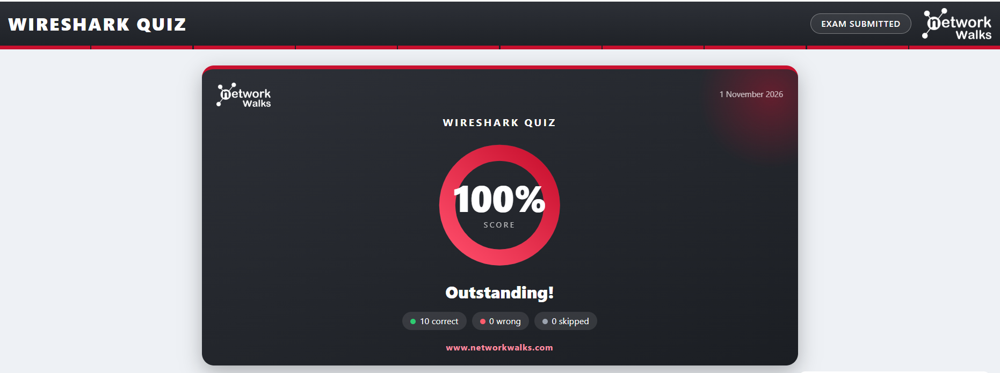
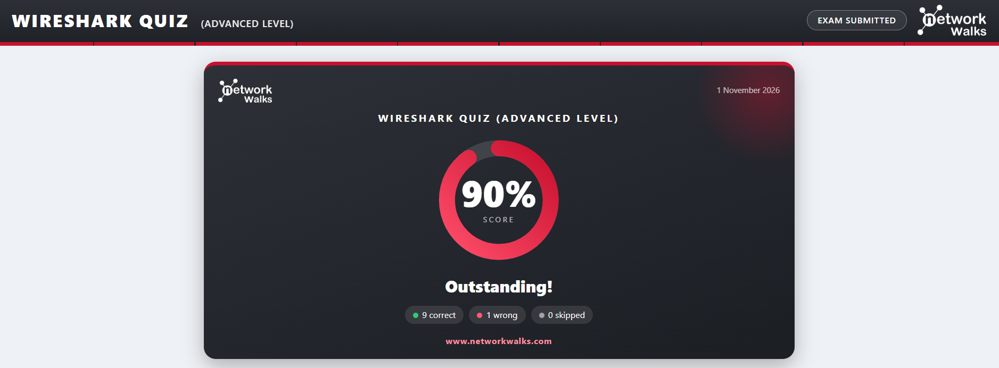

# Wireshark SOC Labs: Networkwalks Internship (Week 1, Extra Project)

Hands-on packet analysis project completed as part of the **Networkwalks Cybersecurity Internship**. Acting as a SOC analyst, I investigated 6 browser-based Wireshark labs (10 tasks each, 60 tasks in total) covering attack detection, plain-text protocol analysis, credential exposure, brute force detection and VoIP call reconstruction. I also completed two Wireshark quizzes.

> All labs were performed inside the Networkwalks lab environment on simulated traffic. No real networks were captured or tested.

---

## Skills Demonstrated

- Capturing and analysing traffic with **Wireshark**
- Display filters (`tcp.flags.syn == 1`, `ftp.response.code == 530`, `http.request.method == "POST"`, `sip`, `rtp`, etc.)
- **Follow TCP Stream** to reconstruct conversations
- Statistics tools: **Conversations** and **Protocol Hierarchy**
- Detecting **port scans** and **brute force** attacks
- Finding **clear-text credentials** (HTTP, FTP, chat)
- Finding **hidden data** in HTTP responses (HTML comments)
- **VoIP analysis**: SIP signalling, RTP streams, codec identification and call playback
- Recommending security fixes (HTTPS, TLS, SRTP, encrypted tools, account lockout)

---

## Labs Overview

| # | Lab | Focus | Key Findings |
|---|-----|-------|--------------|
| 3 | **Identify the Attacker's IP** | SYN packet analysis, port scan detection | Attacker `192.168.10.66` scanned 40 ports on web server `192.168.10.20`. Open: 22, 80, 443. Closed ports replied `RST, ACK`. Attack type: **Port scan** |
| 4 | **Follow TCP Stream** | Plain-text chat on TCP 5000 | Chat from `192.168.10.45` to `192.168.10.20` (stream 5, 413 bytes). Temporary and guest Wi-Fi passwords were exposed in clear text. Lesson: use encrypted tools (TLS/HTTPS) |
| 5 | **Follow TCP Stream, Part 2** | Hidden data in HTTP | Hidden note in `/staff.html` (stream 7) inside an **HTML comment**, travelling server to client. It revealed an access code and a backup server IP. Also found the downloaded `report.txt` |
| 6 | **HTTP Plain Text Credentials** | Credential exposure over HTTP | `POST /login` from `192.168.10.45`, 2 attempts (1 failed, 1 worked). Credentials were readable under *HTML Form URL Encoded*. Fix: **use HTTPS** |
| 7 | **Catch the Brute Force Attacker** | FTP brute force | Attacker `192.168.10.66` targeted FTP server `192.168.10.20` with 24 failed logins (code 530) for user `admin`, then one success (code 230). Attack type: **Brute force** |
| 8 | **Catch the Call Scammer** (VoIP call replay) | SIP / RTP analysis | Call set up with **SIP** (UDP 5060), voice carried by **RTP** (G.711 PCMU), caller extension 101, answered by extension 202. Payment details were spoken in an unencrypted call. Fix: **SRTP + TLS** |

Each lab folder contains the lab solution PDF downloaded after completing all 10 tasks.

---

## Repository Structure

```
wireshark-soc-labs/
├── README.md
├── labs/        -> solution PDFs of all 6 labs
└── quizzes/     -> screenshots of the 2 quiz results
```

---

## Wireshark Quizzes

I also completed both Wireshark quizzes on the Networkwalks platform (1 November 2026).

| Quiz | Score | Result |
|------|-------|--------|
| Wireshark Quiz | **100%** | 10 correct, 0 wrong, 0 skipped |
| Wireshark Quiz (Advanced Level) | **90%** | 9 correct, 1 wrong, 0 skipped |




---

## Key Takeaways

1. **Port scans** show up as one source sending many SYNs to many ports in a fraction of a second. Open ports answer `SYN, ACK`, closed ports answer `RST, ACK`.
2. **Brute force** shows up as repeated failed logins (FTP 530) from one IP for one username, followed by a success (230).
3. **Unencrypted protocols** (HTTP, FTP, plain chat, SIP/RTP) expose passwords, hidden data and even spoken payment details to anyone who can sniff the traffic.
4. **Mitigations:** HTTPS/TLS, encrypted chat tools, SRTP for VoIP, and monitoring for scan and brute-force patterns.

---

## About

**Name:** Malik Muhammad Faheem Badar
**Program:** Networkwalks Cybersecurity Internship, Week 1
**LinkedIn:** *(your LinkedIn URL)*

Lab platform: [networkwalks.com/wireshark](https://networkwalks.com/wireshark/)
